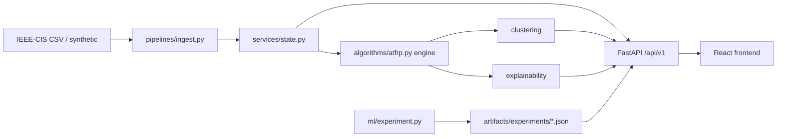

# Architecture (implemented)

In-memory state (no database yet). Clusters are detected time-sliced (`clustering/timeline.py`): a fresh replay snapshots cluster state at checkpoints using only past events; per-transaction scores are prediction-time. Changing cluster settings re-runs that replay.
